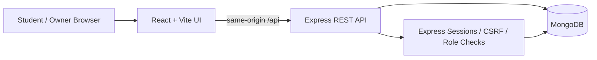
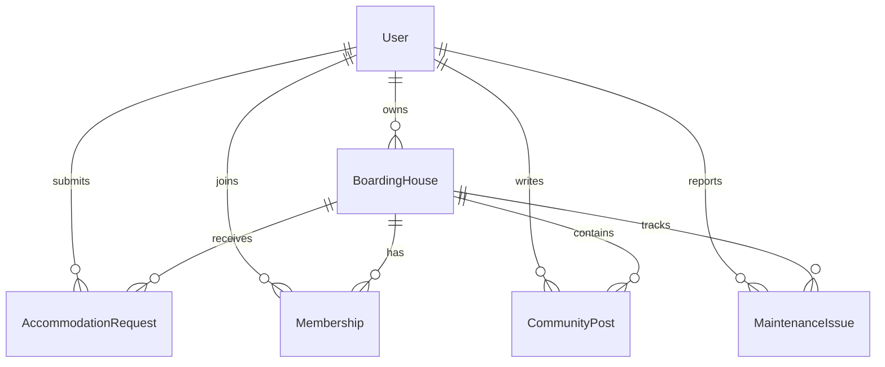

# BoardInG — Technical Architecture and Data Model

## Architecture

Development frontend runs on port 5173 and proxies `/api` to Express on port 5000. Express connects to MongoDB at localhost port 27017. Browser authentication uses a server-side session backed by MongoDB and an HTTP-only cookie; state-changing requests need a CSRF token. Roles (STUDENT/OWNER) and residency checks are enforced on the backend.

## Mongoose collections

| Collection | Key fields | Purpose |
|---|---|---|
| User | `name`, `email`, `passwordHash`, `role` | Authentication / owner or student role |
| BoardingHouse | `ownerId`, `title`, `city`, `area`, `monthlyRentLkr`, `availability`, `status` | Listings and search |
| AccommodationRequest | `studentId`, `boardingHouseId`, `status`, `message` | Offline residence requests |
| Membership | `studentId`, `boardingHouseId`, `status`, `joinedAt` | Authorizes private access |
| CommunityPost | `boardingHouseId`, `authorId`, `type`, `content` | Posts and announcements |
| MaintenanceIssue | `boardingHouseId`, `studentId`, `title`, `description`, `status` | Maintenance tracking |

The request and membership models have a unique compound index on `(studentId, boardingHouseId)`.

## State transitions

- Accommodation request: `PENDING -> APPROVED` or `PENDING -> REJECTED`.
- Membership: approval creates `ACTIVE`; owner can revoke to `REVOKED`. Old approved requests cannot reactivate a revoked membership.
- Maintenance: `OPEN`, `IN_PROGRESS`, `RESOLVED`.
- House: `ACTIVE -> ARCHIVED`; search only exposes active houses.

**Known architectural limit:** approving a request and writing a membership are separate MongoDB operations in this MVP. Standalone MongoDB has no multi-document atomicity for this flow; a replica set + transaction would be advisable for a production booking/residency platform.

## Future extensions (not part of the submitted MVP)

Online payments, map integration, automatic inventory, real-time chat, identity/property verification, and transaction-backed approvals.
